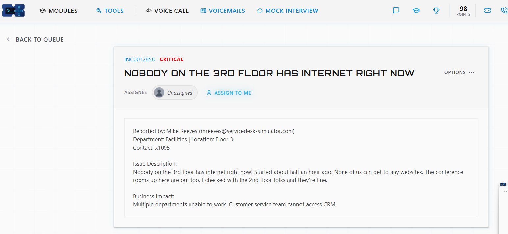
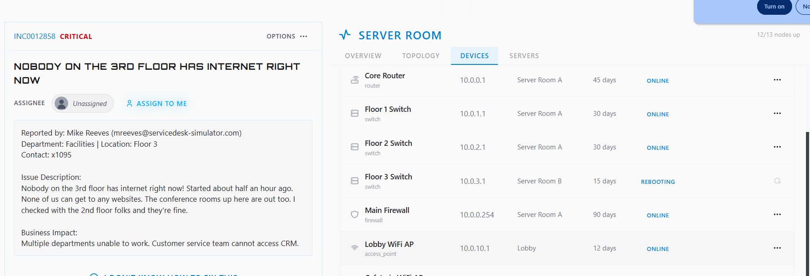
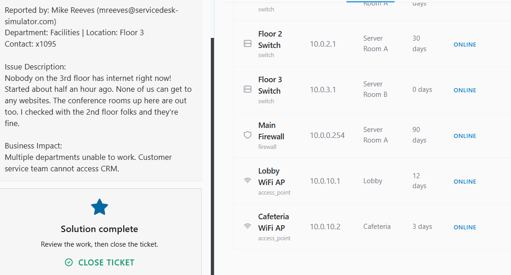

# Ticket: Nobody on the 3rd floor has internet

**Ticket:** INC0012858 | **Priority:** CRITICAL | **Status:** Resolved and closed

## Scenario
Mike Reeves (Facilities, Floor 3) reported that nobody on the 3rd floor could reach any websites, starting about half an hour earlier. The 3rd-floor conference rooms were down too. He had already checked with the 2nd floor, and they were fine.
**Business impact:** multiple departments couldn't work, and the customer service team couldn't access the CRM.

## Environment
- ServiceDesk Simulator (help desk training platform)
- Server Room tool: device list with IP, location, uptime, and status for the core router, firewall, floor switches, and Wi-Fi access points

## Troubleshooting steps
1. **Scoped the outage.** A whole floor was down (including the conference rooms) while the floor below worked. That pointed away from one user's PC and toward shared equipment serving Floor 3.
2. **Checked the upstream devices.** In the **Server Room**, I confirmed the Core Router (10.0.0.1), Main Firewall (10.0.0.254), and the Floor 1 and Floor 2 switches were all online, which ruled out the internet connection and the core network.
3. **Isolated the Floor 3 switch** (10.0.3.1, Server Room B) as the likely cause, since it is the device that serves only that floor.
4. **Restarted the Floor 3 switch** and watched its status change from *Rebooting* to *Online*. Uptime reset to 0 days, confirming the restart happened.
5. **Verified the fix** and closed the ticket.

## Resolution
After the restart, the Floor 3 switch came back online and the simulator marked the solution complete. I reviewed the work and closed the ticket.

## Skills shown
- Triage of a CRITICAL, multi-user outage
- Scoping: "who else is affected?" before touching anything
- Working from the top of the network down (router, firewall, then the floor switch)
- Reading a device inventory (IP, location, uptime, status)
- Confirming the fix before closing

## What I'd do in production
- **Communicate early:** send an outage notice to Floor 3 and update the ticket while working, since it's critical.
- **Check before rebooting:** look at the switch logs, port status, and power/UPS so the root cause isn't lost in a restart.
- **Follow change rules:** confirm I'm allowed to restart network gear, or escalate to the network team.
- **Confirm with users:** have someone on Floor 3 (and the conference rooms) test before closing.
- **Root cause:** if the switch keeps failing, escalate for a firmware check, hardware replacement, or monitoring alerts.
- **Document** the cause, steps, and fix in the ticket.
