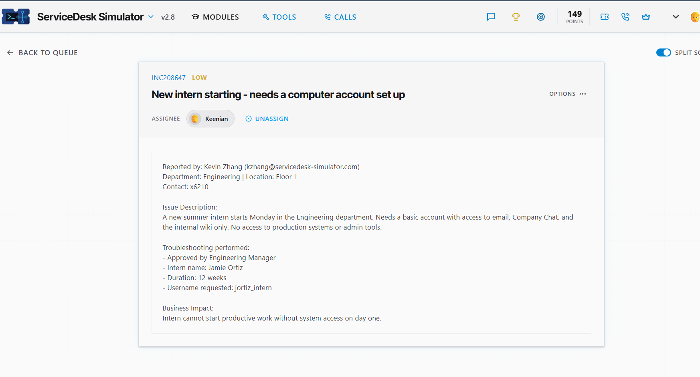
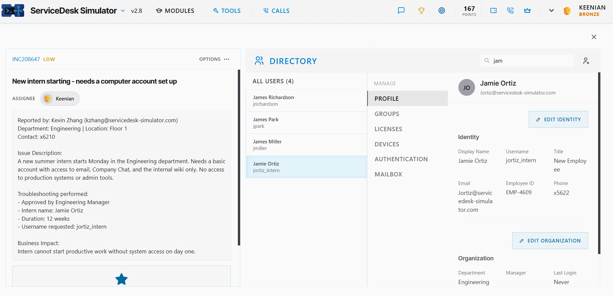

# Ticket: New intern starting - needs a computer account set up

**Ticket:** INC208647 | **Priority:** LOW | **Assignee:** Keenian

## Scenario
Kevin Zhang (Engineering, Floor 1) reported that a new summer intern starts Monday in the Engineering department and needs a basic account with access to **email, Company Chat, and the internal wiki only**. No access to production systems or admin tools.
- **Intern:** Jamie Ortiz
- **Duration:** 12 weeks
- **Username requested:** `jortiz_intern`
- **Approval:** Engineering Manager

**Business impact:** the intern can't start productive work without system access on day one.

## Environment
- ServiceDesk Simulator v2.8 (help desk training platform)
- Directory tool (user profile, groups, licenses, devices, authentication, mailbox)

## Steps taken
1. **Read the request and confirmed approval.** The ticket states it was approved by the Engineering Manager, so the account request was authorized before I acted.
2. **Noted the scope.** Email, Company Chat, and internal wiki only, with no production or admin access. This is a least-privilege, temporary (12-week) account.
3. **Set up the account in the Directory** using the requested username.
4. **Verified the profile.** Jamie Ortiz now shows in the Directory with:
   - Username: `jortiz_intern`
   - Email: Jortiz@servicedesk-simulator.com
   - Employee ID: EMP-4609
   - Title: New Employee
   - Department: Engineering
   - Last Login: Never (account ready for day one)

## Result
An approved, scoped intern account (`jortiz_intern`) for Jamie Ortiz is in the Directory under Engineering with an email address, ready before the Monday start.

## What I learned
- Check for approval before creating any account.
- Follow **least privilege**: give an intern only what the request names, and no production or admin access.
- Use the exact username requested so the account matches what the manager expects.
- Verify the result in the directory instead of assuming it worked.

## What I'd do in production
- Set an **account expiration date** to match the 12-week internship.
- Grant access through **groups** for email, chat, and wiki rather than one-off permissions.
- Send the manager the login details through an approved, secure channel.
- Document the approval and access granted on the ticket for audits and offboarding.
