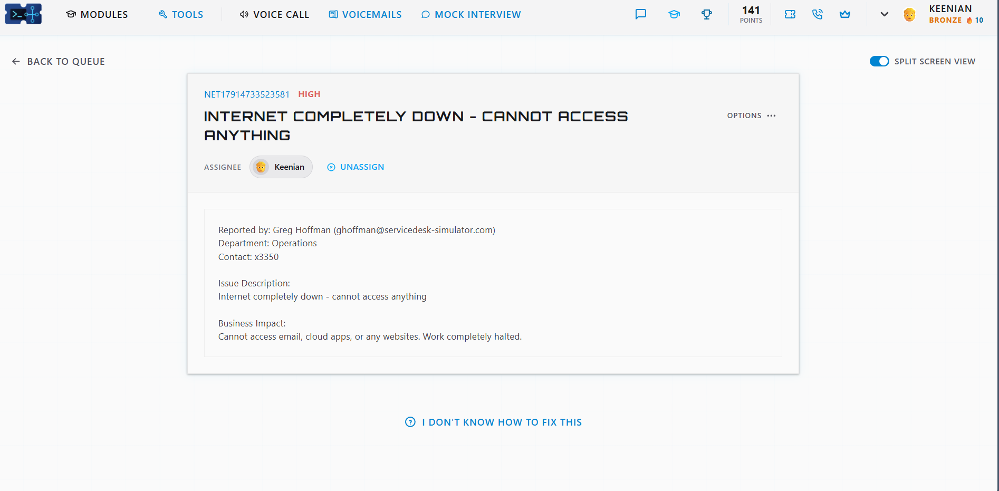
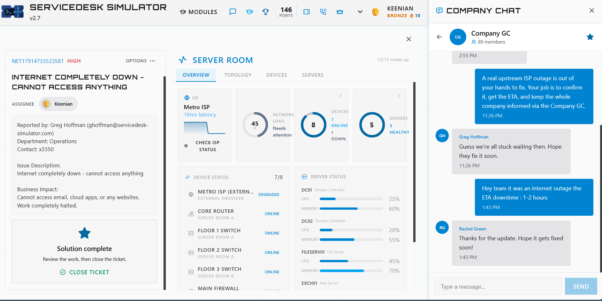

# Ticket: Internet completely down, cannot access anything

**Ticket:** NET17914733523581 | **Priority:** HIGH | **Status:** Resolved and closed

## Scenario
Greg Hoffman (Operations) reported that the internet was completely down and he couldn't access anything.
**Business impact:** no email, cloud apps, or websites. Work completely halted.

## Environment
- ServiceDesk Simulator v2.7 (help desk training platform)
- Server Room overview: ISP status, network load, device status, server status
- Company group chat (89 members)

## Troubleshooting steps
1. **Scoped it.** "Completely down, can't access anything" pointed to the network or internet connection, not a single PC.
2. **Checked the internal network first.** In the Server Room, the Core Router and the Floor 1, 2, and 3 switches were online, and the servers (DC01, DC02, FILESERV01, and others) were healthy.
3. **Found the cause upstream.** The external provider, **Metro ISP**, showed **DEGRADED**. I used *Check ISP Status* to confirm it was an upstream ISP outage.
4. **Recognized the limit of help desk.** An ISP outage can't be fixed in-house. The job was to confirm it, get the ETA, and keep the company informed.
5. **Communicated to everyone.** I posted in the Company group chat: *"Hey team it was an internet outage the ETA downtime: 1-2 hours."* Users acknowledged the update.
6. **Closed the ticket** after the solution was marked complete.

## Resolution
Confirmed an upstream ISP outage, shared the 1–2 hour ETA with the whole company, and closed the ticket.

## Skills shown
- Inside-out troubleshooting: internal network and servers before the ISP
- Reading a network/server status dashboard
- Knowing what's in help desk's control and what isn't
- Outage communication to the whole company, with an ETA

## What I'd do in production
- **Open a ticket with the ISP** and record its ticket number and ETA.
- **Fail over** to a backup internet connection if one exists.
- **Post updates on a schedule** (e.g., every 30 minutes) through the official channel, even if nothing has changed.
- **Escalate** to the network team or manager, and link duplicate user tickets to one parent incident.
- **Confirm recovery:** once service returns, check with users, then close the related tickets.
- **Document** the start and end times and the cause for the incident report.
