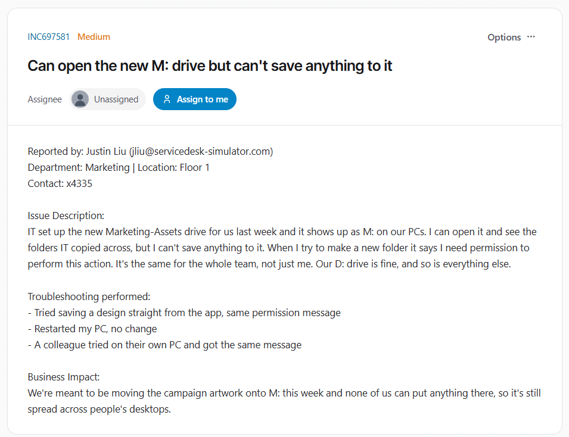
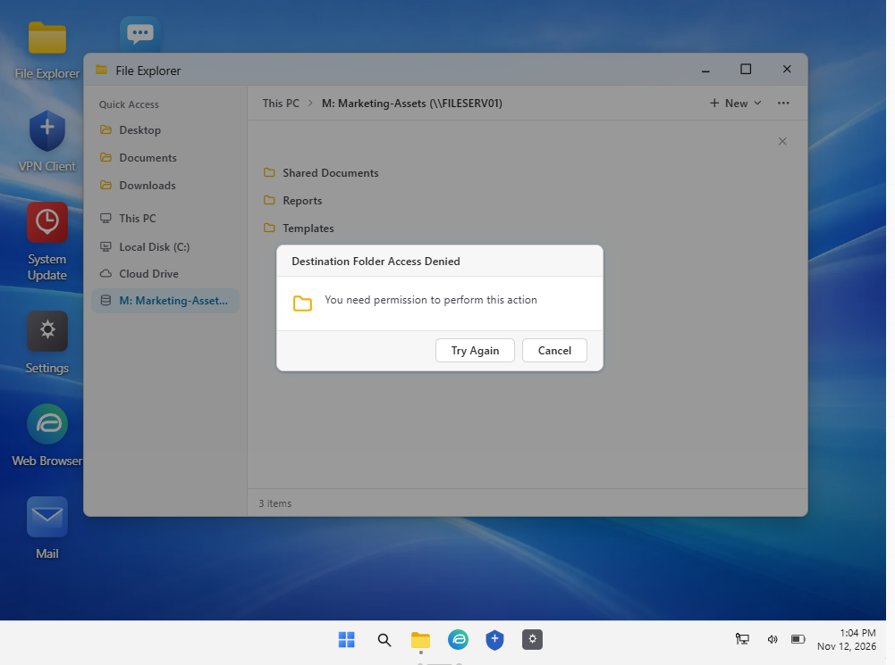
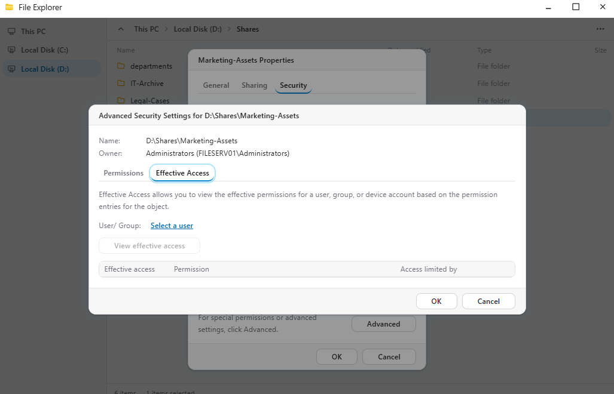
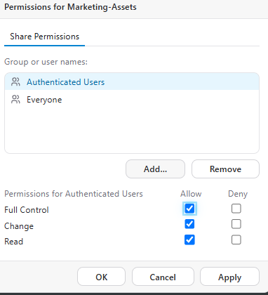
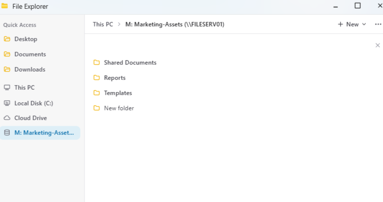

# Ticket: Can open the new M: drive but can't save anything to it

**Ticket:** INC697581 | **Priority:** MEDIUM | **Assignee:** Keenian

## Scenario
Justin Liu (Marketing, Floor 1) reported that he could open the new M: drive but couldn't save anything to it. The whole Marketing team got "Destination Folder Access Denied" when saving to M: (`\\FILESERV01\Marketing-Assets`).

**Business impact:** the team needed to move campaign artwork onto M: this week, and none of them could save files there.

## Environment
- ServiceDesk Simulator
- File server: **FILESERV01**
- Share path: `D:\Shares\Marketing-Assets` (mapped as **M:**)
- Tools: Remote Desktop, Advanced Security Settings (Effective Access)

## Steps taken
1. **Reproduced the error.** I opened M: and got the same "Destination Folder Access Denied" message, confirming it was not user error.

2. **Narrowed the scope.** The issue hit multiple users and PCs. Read access worked but write access failed, which pointed to a server-side permissions problem rather than an individual workstation.

3. **Remoted into the file server.** I connected over Remote Desktop to FILESERV01 and found the folder at `D:\Shares\Marketing-Assets`.

4. **Diagnosed with Effective Access.** I used Advanced Security Settings > Effective Access on Justin Liu's account. On the NTFS Security tab, the Marketing group (`servicedesk-simulator\Marketing`) already had Modify, Read & execute, List folder contents, Read, and Write, along with Administrators and SYSTEM. The restriction was coming from the share permissions (Authenticated Users and Everyone).

5. **Updated the share permissions.** I updated share permissions so Authenticated Users have Change access, which lets the existing NTFS Modify permission take effect. The screenshot shows Full Control, Change, and Read checked; under least privilege, Change is enough.

6. **Verified the fix and confirmed with the user.** I created a New folder on M: to prove write access. The user confirmed: "Just tested it - everything seems fine now."

## Result
Write access to the Marketing-Assets share was restored. A test folder could be created on M:, and the user confirmed the fix. Ticket closed.

## What I learned
- Always check both layers: share permissions and NTFS permissions. The most restrictive one wins.
- Effective Access is a fast way to see why an account is blocked.
- On share permissions, Change is enough for users to write; Full Control is more than least privilege requires.
- Don't close the ticket until the user confirms the fix.
