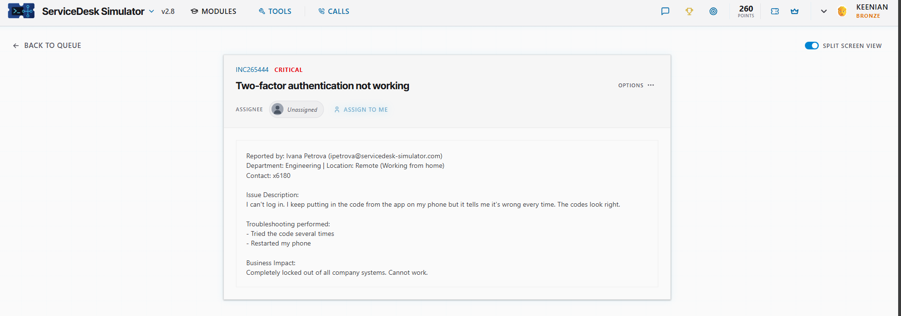
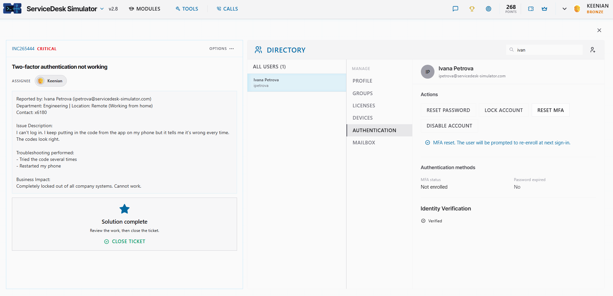
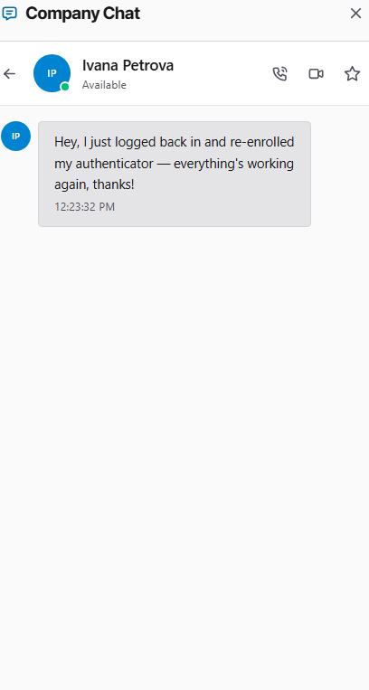

# Ticket: Two-factor authentication not working

**Ticket:** INC265444 | **Priority:** CRITICAL | **Assignee:** Keenian

## Scenario
Ivana Petrova (Engineering, Remote / WFH) reported she couldn’t log in. Codes from her authenticator app were rejected every time, even after she restarted her phone.

**Business impact:** completely locked out of all company systems — unable to work.

## Environment
- ServiceDesk Simulator v2.8 (help desk training platform)
- Directory Admin → Authentication (MFA reset)

## Steps taken
1. **Assigned the ticket and reviewed the report.** CRITICAL priority, remote engineer fully locked out. She had already tried multiple codes and a phone restart.
2. **Verified identity before changing authentication.** Directory showed Identity Verification: Verified. Password was not expired.
3. **Reset MFA.** Used **RESET MFA** under Authentication. Confirmation: “MFA reset. The user will be prompted to re-enroll at next sign-in.” MFA status moved to Not enrolled.

4. **Confirmed with the user.** Ivana messaged on Company Chat that she had logged back in, re-enrolled her authenticator, and everything was working again.
5. **Closed the ticket** after her confirmation.

## Result
Ivana’s MFA was reset, she re-enrolled successfully, and she regained access to company systems. Ticket closed as solution complete.

## What I learned
- On authentication tickets, verify identity before any reset.
- Reset MFA so the user re-enrolls cleanly — don’t keep forcing failed codes.
- Confirm password state and enrollment status after the change.
- Don’t close a CRITICAL lockout until the user confirms they’re back in.
