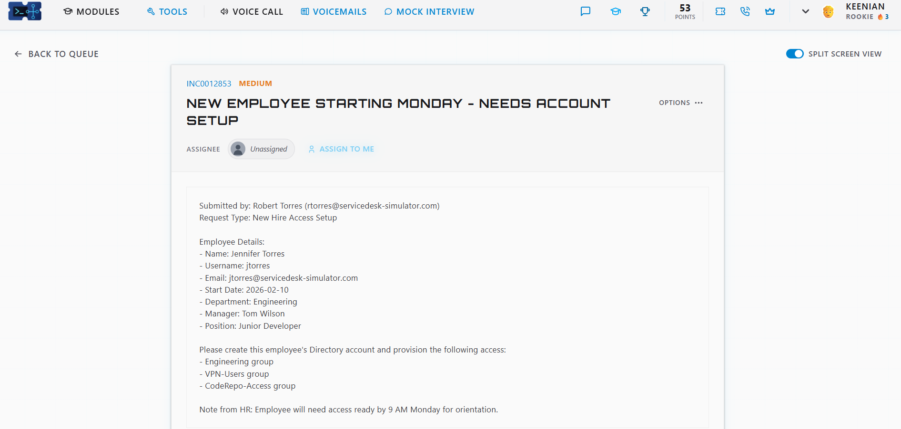
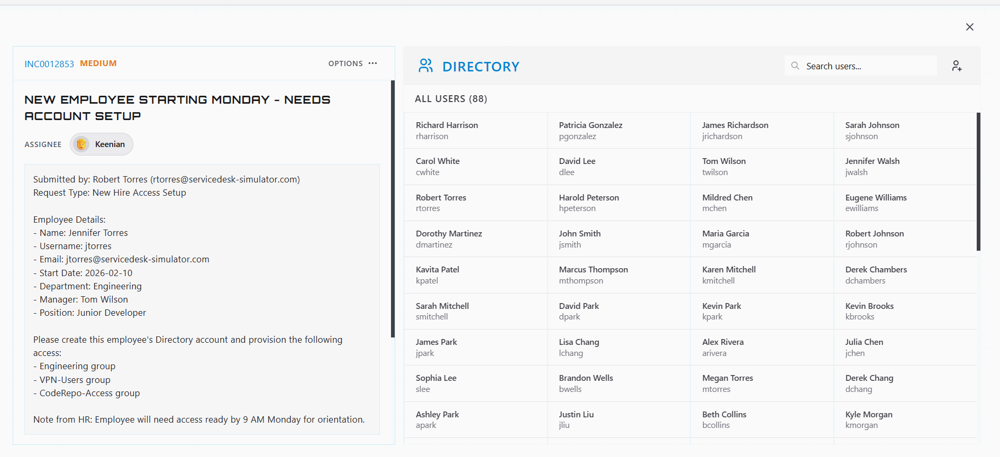
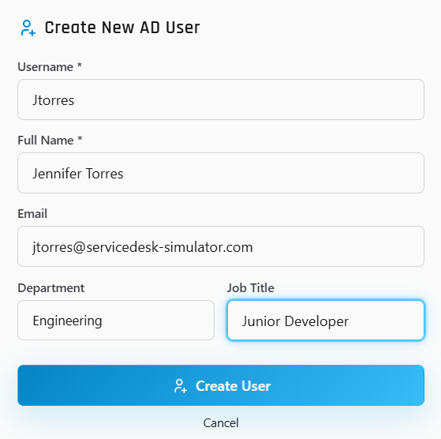
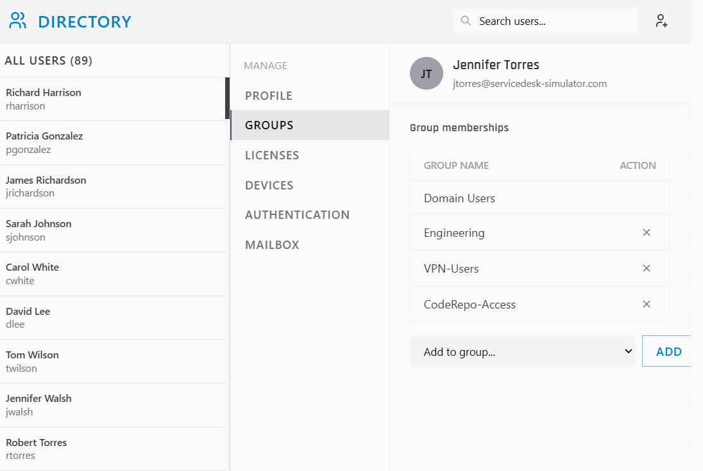

# Ticket: New employee starting Monday needs account setup

**Ticket:** INC0012853 | **Priority:** MEDIUM | **Status:** Completed

## Scenario
Robert Torres submitted a request to set up accounts for a new hire starting Monday.
- **New hire:** Jennifer Torres, Junior Developer, Engineering
- **Manager:** Tom Wilson
- **Username / email:** jtorres / jtorres@servicedesk-simulator.com
- **Start date:** 2026-02-10

**Business impact:** HR noted that access had to be ready by **9 AM Monday**, so she could start working on day one.

## Environment
- ServiceDesk Simulator (help desk training platform)
- Tools used: Directory (Active Directory users and groups)

## Steps
1. Read the ticket, noted the HR deadline, and **assigned the ticket to myself** so ownership was clear.
2. Opened the **Directory** and searched for an existing account before creating anything (88 users), to avoid creating a duplicate.
3. **Created the AD user** with the username, full name, email, department (Engineering), and job title (Junior Developer). The directory count went from 88 to 89 users.
4. Added her to the security groups her role needs: **Engineering**, **VPN-Users**, and **CodeRepo-Access**. **Domain Users** was applied by default.

## Resolution
Jennifer's account was created with the correct details and role-based group access (department, remote access, and code repository), ready before her Monday start.

## Skills shown
- Ticket ownership and working to a deadline (HR's 9 AM Monday requirement)
- Checking the directory for an existing account before provisioning
- Active Directory user creation with accurate attributes (name, email, department, title)
- Role-based access through security groups (Engineering, VPN-Users, CodeRepo-Access)
- Following the details in the request exactly

## Lessons learned
- **Follow the username convention exactly.** I typed the username as `Jtorres` with a capital J instead of `jtorres`. Usernames should match the naming standard in the ticket; I'd double-check the field before saving.

## What I'd do in production
- **Verify the request:** confirm the new hire and access list with HR or the manager (Tom Wilson) before provisioning.
- **Least privilege:** only add the groups the role needs; get approval for anything extra.
- **Initial password:** set a temporary password with "must change at next logon" and give it to the user or manager through a secure channel, never plain email.
- **Licenses and mail:** assign the Microsoft 365 license and confirm the mailbox exists.
- **Test before day one:** confirm sign-in, VPN, and repo access work, then update the ticket and notify the manager.
- **Document:** record what was created and which groups were assigned in the ticket notes.
