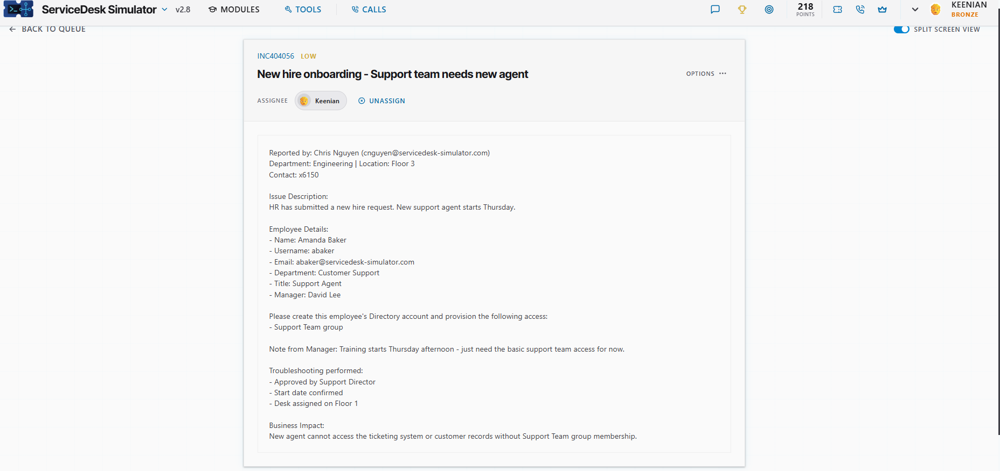
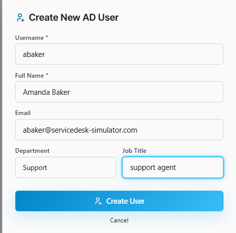
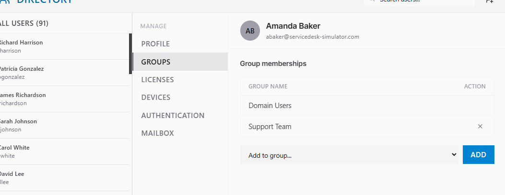

# Ticket: New hire onboarding - Support team needs new agent

**Ticket:** INC404056 | **Priority:** LOW | **Assignee:** Keenian

## Scenario
Chris Nguyen (Engineering, Floor 3) reported that a new Support Agent is joining the Customer Support team and needs to be set up before day one.
- **New hire:** Amanda Baker
- **Username:** `abaker`
- **Email:** abaker@servicedesk-simulator.com
- **Department:** Customer Support (Support)
- **Title:** Support Agent
- **Manager:** David Lee
- **Start date:** Thursday, desk on Floor 1
- **Approval:** Support Director
- **Required:** Directory account + **Support Team** group

**Business impact:** the new agent can't start working support tickets on Thursday without an account and team access.

## Environment
- ServiceDesk Simulator (help desk training platform)
- Active Directory user creation and group membership tools

## Steps taken
1. **Read the request and confirmed approval.** The ticket states the Support Director approved the hire, so the account request was authorized before I acted.
2. **Created the AD user.** Filled in the Create New AD User form with:
   - Username: `abaker`
   - Display name: Amanda Baker
   - Email: abaker@servicedesk-simulator.com
   - Department: Support
   - Title: Support Agent

3. **Added the Support Team group.** Added Amanda to **Support Team** as the ticket required, alongside the default **Domain Users** group.
4. **Verified group memberships.** Her account shows Domain Users + Support Team.

## Result
Amanda Baker's approved directory account (`abaker`) is created in the Support department with the Support Team group, ready for her Thursday start.

## What I learned
- Confirm approval before creating any account.
- Match the username, email, department, and title exactly to the ticket.
- Give access through groups (Support Team) instead of one-off permissions.
- Verify group memberships after the change instead of assuming it worked.
