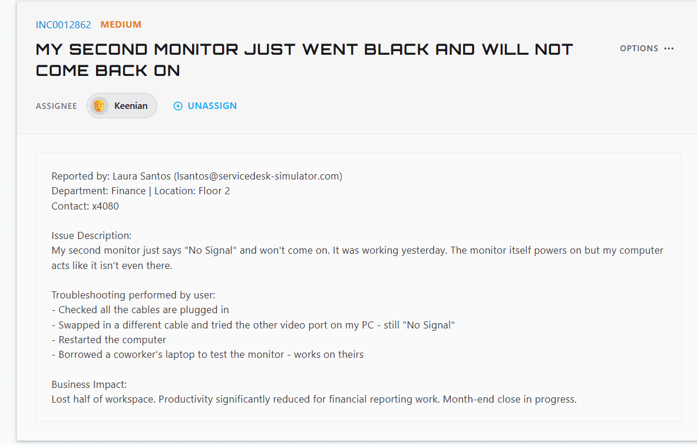
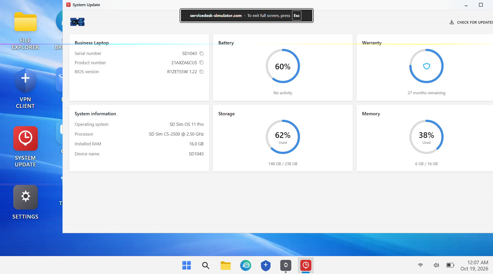

# Ticket: Second monitor went black and won't come back on

**Ticket:** INC0012862 | **Priority:** MEDIUM | **Status:** Resolved and closed

## Scenario
Laura Santos (Finance, Floor 2) reported that her second monitor showed "No Signal." The monitor powered on, but her computer acted like it wasn't there. It had worked the day before.
**Business impact:** she lost half her workspace during month-end close, slowing down financial reporting.

She had already:
- Checked that all cables were plugged in
- Swapped in a different cable and tried the other video port (still "No Signal")
- Restarted the computer
- Tested the monitor on a coworker's laptop, where it worked

## Environment
- ServiceDesk Simulator (help desk training platform)
- User laptop: SD1043, SD Sim OS 11 Pro, 16 GB RAM
- System Update tool (device info, drivers/updates, warranty)

## Troubleshooting steps
1. **Read the user's notes first.** The monitor worked on another laptop, and a new cable and the other port didn't help. That ruled out the monitor, the cable, and the port.
2. **Narrowed it to the PC.** With the hardware ruled out and the setup working yesterday, the likeliest cause was software on her laptop, especially the display/graphics driver.
3. **Opened System Update** on the laptop (SD1043) and checked the device information and available updates.
4. **Updated the display/graphics driver** through System Update.
5. **Verified the fix:** after the update, the second monitor came back. Then I closed the ticket.

## Resolution
Updating the display/graphics driver through System Update brought the second monitor back.

## Skills shown
- Using the user's own troubleshooting to skip repeat steps
- Process of elimination: monitor, cable, port, then PC
- Driver updates with a system update tool
- Respecting business impact (month-end close) by going straight to the likely cause

## What I'd do in production
- **Check Device Manager / display settings** for the adapter and whether Windows detects the monitor (Win+P, "Detect").
- **Find out what changed:** a recent Windows or driver update can break a working driver. If so, roll the driver back.
- **Use approved drivers** from the vendor or IT's software tool, not random downloads.
- **Docking station:** if the monitor goes through a dock, update the dock firmware and test without it.
- **Give a workaround** during month-end (a loaner monitor, or setting up a single-screen layout) if the fix takes longer.
- **Document** the driver version before and after in the ticket.
