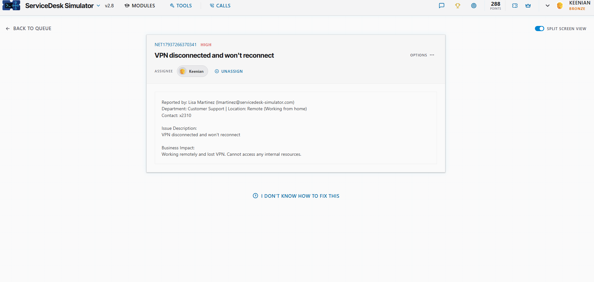
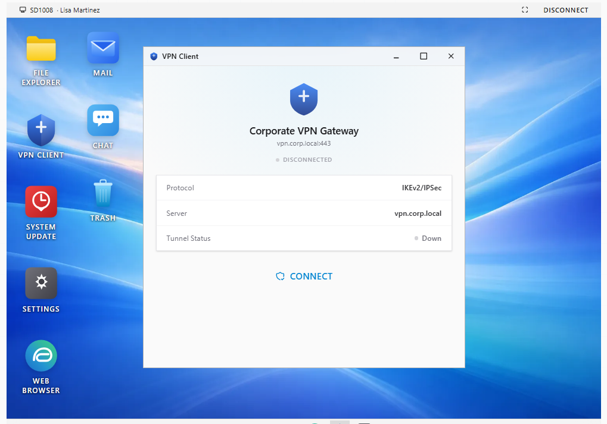
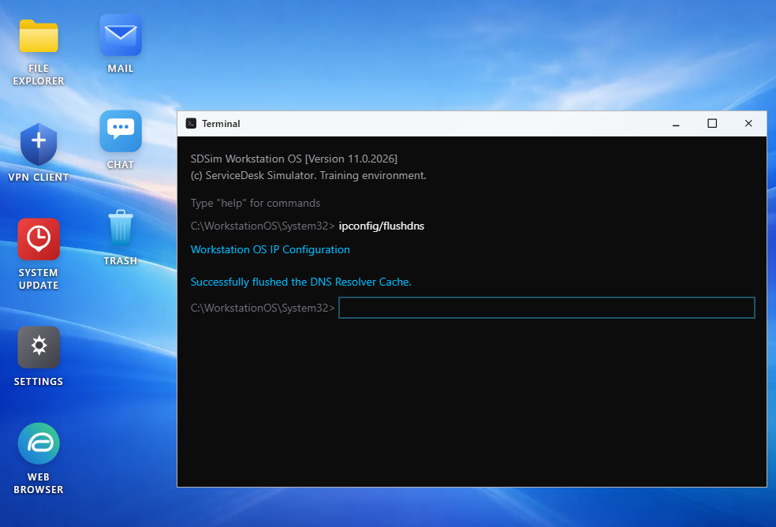
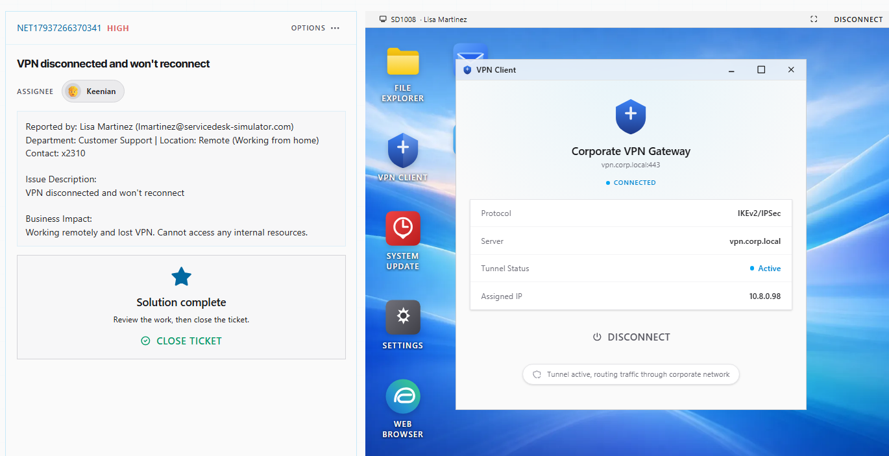

# Ticket: VPN disconnected and won't reconnect

**Ticket:** NET17937266370341 | **Priority:** HIGH | **Assignee:** Keenian

## Scenario
Lisa Martinez (Customer Support, Remote / WFH) reported her VPN disconnected and would not reconnect.

**Business impact:** working remotely with no VPN — cannot access any internal resources.

## Environment
- ServiceDesk Simulator v2.8
- User workstation: **SD1008** (Lisa Martinez)
- Tools: Remote Desktop, Terminal, VPN Client

## Steps taken
1. **Assigned the ticket** and reviewed impact (HIGH, remote user fully blocked from internal systems).
2. **Connected over Remote Desktop** to SD1008.
3. **Checked the VPN Client.** Corporate VPN Gateway (`vpn.corp.local:443`) showed **DISCONNECTED**, protocol IKEv2/IPSec, tunnel status **Down**.

4. **Flushed DNS.** Opened Terminal and ran `ipconfig /flushdns`. Result: *Successfully flushed the DNS Resolver Cache.*

5. **Reconnected the VPN.** After the flush, connected the client. Status moved to **CONNECTED**, tunnel **Active**, assigned IP `10.8.0.98`, routing through the corporate network.

6. **Closed the ticket** once the solution showed complete with an active tunnel.

## Result
Lisa’s VPN reconnects after a DNS cache flush on her workstation. Internal access restored; ticket closed.

## What I learned
- For remote VPN failures, get on the user’s PC first and confirm the client’s real status.
- Stale DNS can block the VPN gateway from resolving — `ipconfig /flushdns` is a fast Tier-1 check.
- Confirm CONNECTED + Active tunnel (and an assigned VPN IP) before closing a HIGH ticket.
