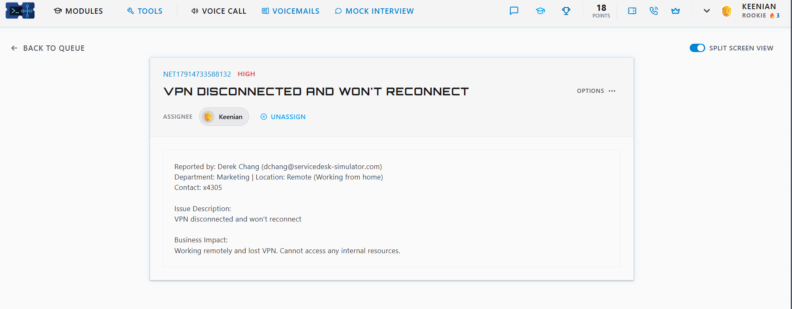
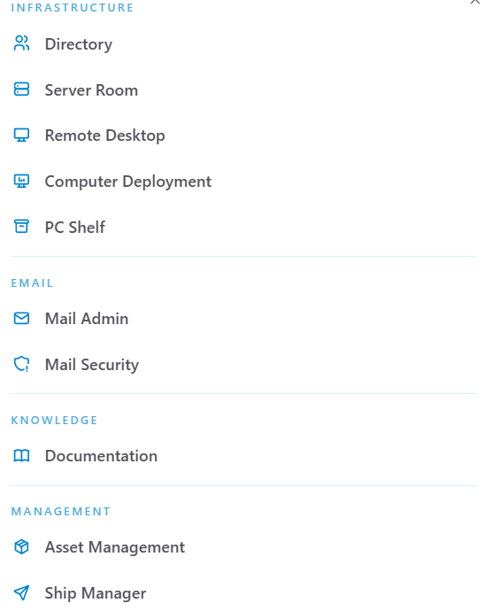
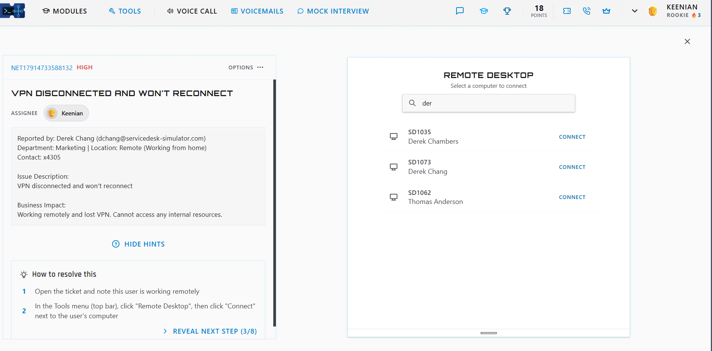
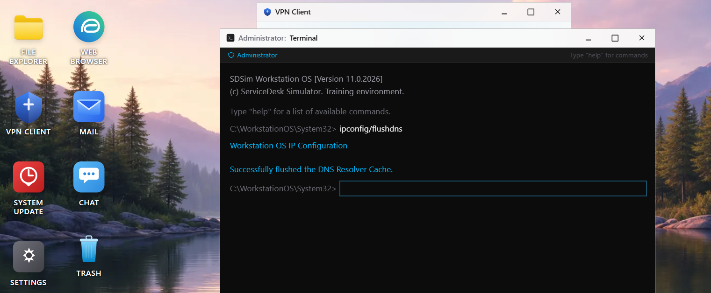
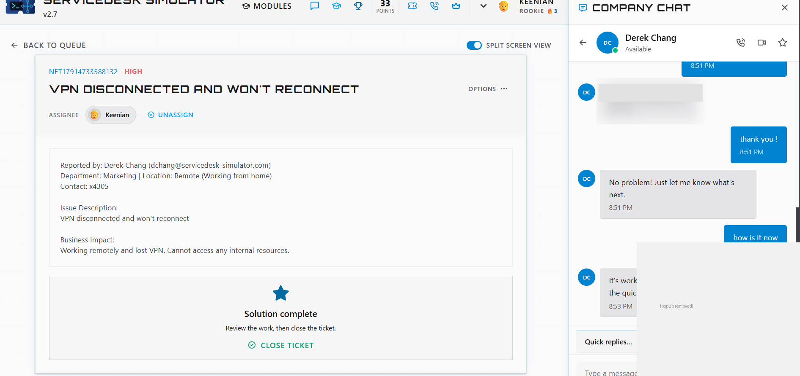

# Ticket: VPN disconnected and won't reconnect

**Ticket:** NET17914733588132 | **Priority:** HIGH | **Status:** Resolved and closed

## Scenario
Derek Chang (Marketing) was working remotely from home when his VPN dropped and wouldn't reconnect.
**Business impact:** he couldn't reach any internal company resources, so he was unable to work.

## Environment
- ServiceDesk Simulator v2.7 (help desk training platform)
- User workstation: SD1073 (Derek Chang)
- Tools available: Directory, Server Room, Remote Desktop, Computer Deployment, PC Shelf, Mail Admin, Mail Security, Documentation, Asset Management, Ship Manager

## Troubleshooting steps
1. Read the ticket and noted the user was remote, so the fix had to happen on his machine over a remote session.
2. Opened **Remote Desktop** from the Tools menu and connected to the user's PC, **SD1073** (checked the name carefully, since a similar user, Derek Chambers, was also listed).
3. Opened an **Administrator terminal** and ran `ipconfig /flushdns` to clear stale DNS entries that can stop the VPN client from resolving the VPN server.
4. Opened the **VPN Client** and reconnected the VPN after clearing the DNS cache.
5. Messaged the user over company chat to confirm he could reach internal resources again.

## Resolution
After the DNS cache was cleared, the VPN client reconnected. The user confirmed over chat that everything was working, and I closed the ticket.

*Sensitive text in the chat has been redacted.*

## Skills shown
- Ticket triage and reading business impact (HIGH priority, remote user blocked)
- Remote support with Remote Desktop
- Windows command line: `ipconfig /flushdns` with admin rights
- VPN client troubleshooting
- Clear communication with the user and confirming the fix before closing

## What I'd do in production
- **Check basics first:** confirm the user's home internet works (can they load a public website?).
- **VPN client logs:** look for the actual error (auth failure, timeout, certificate, DNS) instead of guessing.
- **Credentials and MFA:** check for an expired password, locked account, or MFA prompt that isn't arriving. Never ask a user to share their password; reset it instead.
- **Client version:** make sure the VPN client is up to date and the profile/config is correct.
- **Escalate:** if multiple users are affected or the VPN gateway looks down, escalate to the network team with ticket notes.
- **Document:** record the cause, steps, and fix in the ticket so the next tech can resolve it faster.
